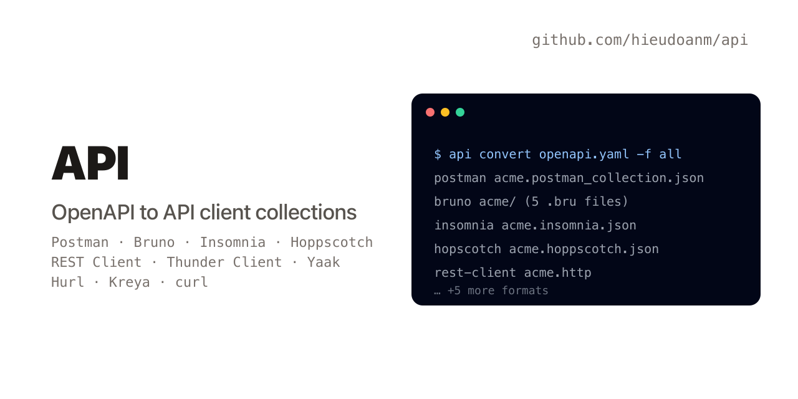
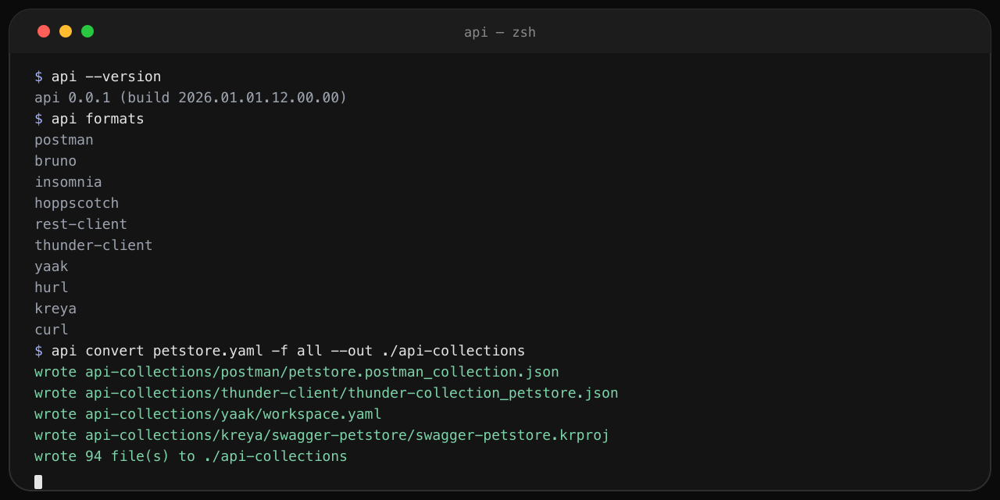

# api

[](https://github.com/hieudoanm/api/actions/workflows/ci.yaml?branch=master) [](LICENSE)

OpenAPI to API client collections — a Rust CLI that converts OpenAPI 3.x specs
(JSON or YAML) into ready-to-import collections for Postman, Bruno, Insomnia,
Hoppscotch, REST Client, Thunder Client, Yaak, Hurl, Kreya and curl.



**Live demo:** <https://hieudoanm.github.io/api/app/>



## Quick start

```bash
cargo run -p api-cli -- convert examples/petstore.yaml --format all --out ./collections
# or, after installing the binary:
api convert openapi.yaml --format postman --out ./collections
```

Supported formats: `postman`, `bruno`, `insomnia`, `hoppscotch`,
`rest-client`, `thunder-client`, `yaak`, `hurl`, `kreya`, `curl` — or `all`. Inputs are OpenAPI 3.x JSON/YAML files, or `-` for
stdin. A no-install browser version lives on the landing page's `/app` route.
See `packages/landing/docs/` for the full CLI reference.

## Repository layout

| Path               | What it is                                                                            |
| ------------------ | ------------------------------------------------------------------------------------- |
| `crates/api-core`  | Conversion engine: OpenAPI parsing, intermediate collection model, emitters.          |
| `crates/api-cli`   | The `api` command-line binary on top of `api-core`.                                   |
| `crates/api-wasm`  | WebAssembly bindings over `api-core`, consumed by the landing app as `@api/wasm`.     |
| `packages/landing` | Next.js static-export landing page + docs site → GitHub Pages at `/api`.              |
| `assets/`          | Canonical branding/demo SVGs; PNGs are generated (`svg-to-png.sh`, `sync-assets.sh`). |
| `examples/`        | `petstore.yaml` sample spec + `examples.sh` batch conversion.                         |
| `scripts/`         | `install.sh` / `install-local.sh` installers.                                         |

## Commands

```bash
cargo build --workspace          # debug build
cargo test --workspace           # Rust tests
cargo clippy --workspace --all-targets -- -D warnings
cargo fmt --all

pnpm install                     # JS workspace (packages/landing + @api/wasm)
pnpm --filter @api/wasm run build:wasm  # generate crates/api-wasm/pkg (gitignored)
pnpm dev                         # landing dev server → :3000/api/
pnpm build                       # landing static export → packages/landing/out
pnpm lint && pnpm typecheck && pnpm test
```

See `packages/landing/AGENTS.md` and `packages/landing/docs/` for the site and
documentation conventions.
