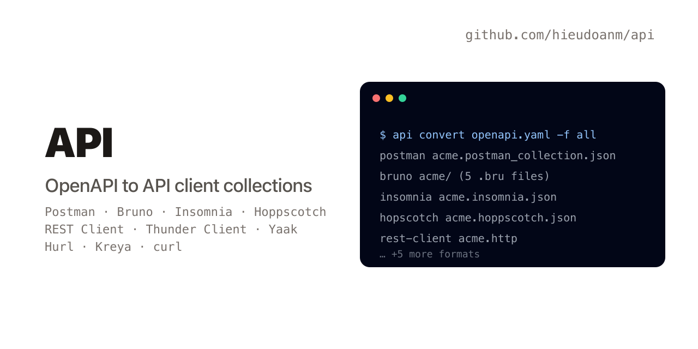

# api — latest build



api converts OpenAPI 3.x specs (JSON or YAML) into ready-to-import collections
for Postman, Bruno, Insomnia, Hoppscotch, REST Client, Thunder Client, Yaak, Hurl, Kreya and curl — or into
standalone browsable API docs pages (Swagger UI, ReDoc, Scalar, Stoplight
Elements, RapiDoc) via `api preview`. One Rust CLI, no
cloud, no accounts.

### Download

| Platform            | Asset                            |
| ------------------- | -------------------------------- |
| Linux x86_64        | `api-x86_64-unknown-linux-gnu`   |
| macOS Apple Silicon | `api-aarch64-apple-darwin`       |
| Windows x86_64      | `api-x86_64-pc-windows-msvc.exe` |

Or install from source:

```sh
./scripts/install.sh            # release binary, cargo fallback
cargo install api-cli           # once published
```

### Quick start

```sh
api convert openapi.yaml --format all --out ./collections
api preview openapi.yaml --format all --out ./docs
```

### Documentation

- [README](https://github.com/hieudoanm/api#readme)
- [Docs site](https://hieudoanm.github.io/api/docs/)
